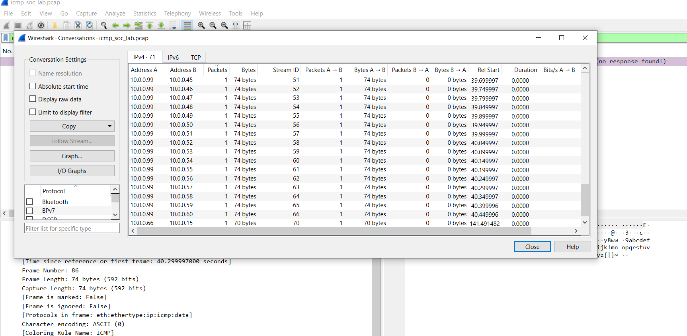
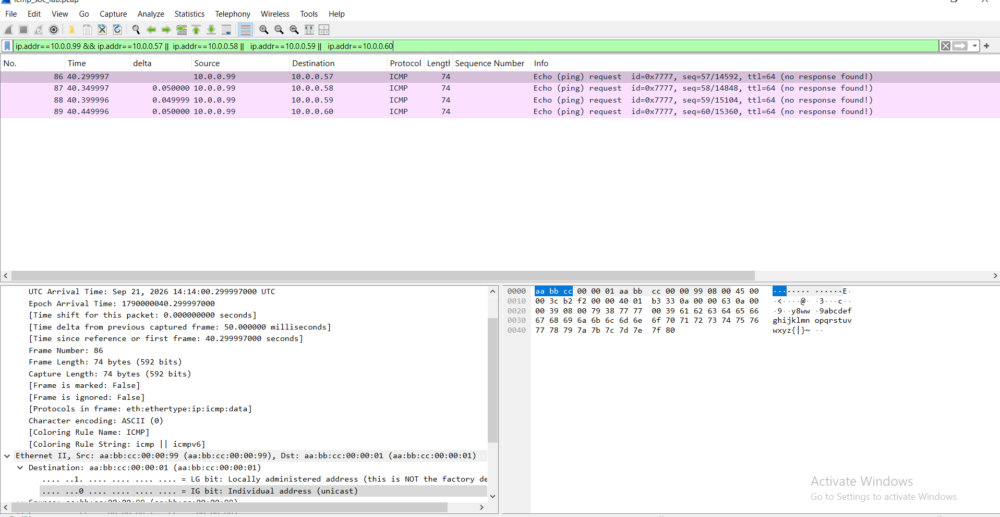
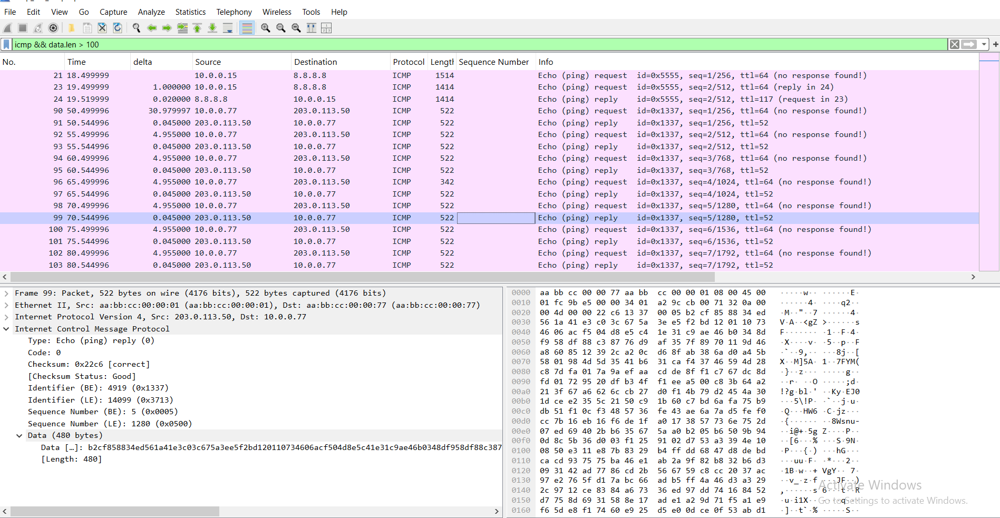
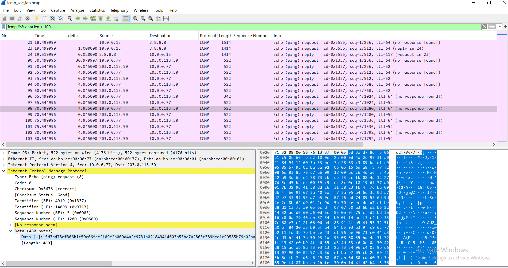
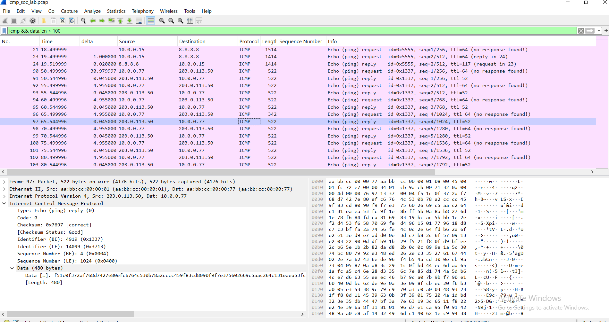
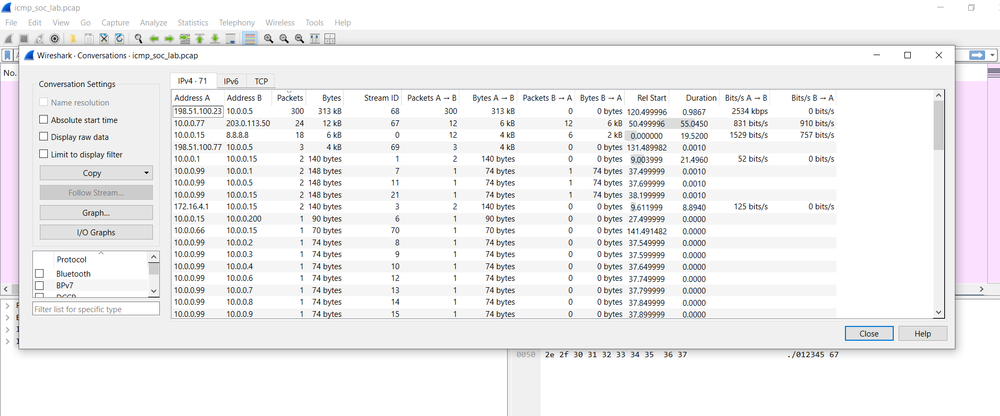
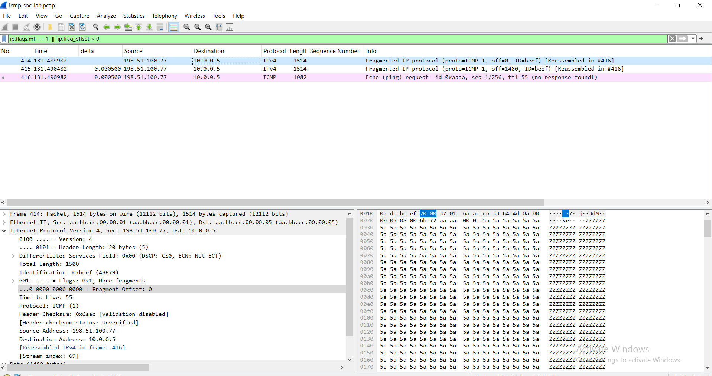

# Findings

Analysis of `pcap/icmp_soc_lab.pcap` (417 packets, 71 IPv4 conversations, synthetic lab data). Each finding lists the evidence, a verdict, the ATT&CK mapping and a recommended action.

## Normal traffic (baseline)

| Frames | Behaviour | Why it's normal |
|---|---|---|
| 1-8 | Ping 10.0.0.15 to 8.8.8.8 | Replies match requests, about 1 s apart, stable RTT, standard payload |
| 9-20 | Traceroute | TTL rises 1 to 6, each hop answers with type 11 |
| 21-24 | Path MTU discovery | DF set, type 3 code 4 (MTU 1400), sender retries smaller |
| 25-26 | Host Unreachable | The gateway reports a dead internal host |

## 1. Ping sweep (frames 27-89): Suspicious

- **Source:** 10.0.0.99
- **Evidence:** 60 echo requests to 10.0.0.1-60, about 50 ms apart (`frame.time_delta_displayed` about 0.05), sequence numbers rising with each target and they are from the same source (10.0.0.99), same identifier (0x7777), identical 32-byte payload. There are no response form most hosts,only 3 hosts answered: 10.0.0.1, .5 and .15.
- **Screenshots:** `02-sweep-conversations.png`, `03-sweep-frames-86-89.png`
- **Meaning:** host discovery of the local subnet, possibly from a compromised host.
- **Action:** identify 10.0.0.99 and confirm it is not an approved scanner. Look for follow-up port scans against the 3 live hosts. Alert on one source pinging more than 20 hosts in 10 seconds.

 

 

## 2. ICMP tunnel (frames 90-113): Suspicious

- **Hosts:** 10.0.0.77 and 203.0.113.50
- **Evidence:**
  -  Payload of 480 bytes when using the data length filter  (icmp && data.len > 100). Frames 90 onward show 522-byte packets, which is 480 bytes of data against a normal ping’s which       is  72 bytes
  - 12 requests and 12 replies over about 55 seconds (24 packets, 12 kB), identifier 0x1337, sequence 1-12.
  - Payload of 480 bytes of random-looking data, against 48 bytes for the lab's normal pings (32 to 56 in practice). Every fourth request (for example frame 96, 342 bytes) is shorter and carries base64 text.
  - Reply data differs from request data: frame 98 data begins `5d3ad78e...` and its reply, frame 99, begins `b2cf8588...` with no readable pattern. A real echo reply repeats the request.
- **Screenshots:** `04-tunnel-large-payloads.png`, `05-tunnel-request-frame-98.png`, `06-tunnel-reply-frame-97.png`
- **Note on the filter:** `icmp && data.len > 100` also matched the legitimate Path MTU packets (frames 21, 23, 24). Those are explained by the DF flag and the type 3 code 4 reply, which is why payload size alone is not enough.
- **Meaning:** covert command-and-control or data exfiltration over ICMP.
- **Action:** investigate the process on 10.0.0.77 that opens a raw ICMP socket, block 203.0.113.50, review what data could have left, and alert on echo payloads over 100 bytes.

 

 

 

## 3. ICMP flood (frames 114-413): Suspicious

- **Source and target:** 198.51.100.23 to 10.0.0.5
- **Evidence:** The ICMP flood was detected in Wireshark’s Statistics > Conversations view, where a single IPv4 conversation between 198.51.100.23 and 10.0.0.5 stood out with 300 packets and 313 kB, all travelling in one direction with no traffic returned. The conversation lasted under one second (0.9867 s) at roughly 2,534 kbps, far above every other ICMP exchange in the capture. Filtering the packets with ip.addr == 198.51.100.23 && ip.addr == 10.0.0.5 confirmed the pattern: fixed 1,000-byte payloads at about 3.3 ms intervals, a single ICMP identifier (0x9999) with a rising sequence number, a constant TTL of 240, and Wireshark flagging every request as “no response found.”
- **Screenshots:** `01-conversations-overview.png`, `07-flood-packets.png`
- **Meaning:** a denial-of-service attempt from a single source. A constant TTL suggests one real sender, though spoofing should still be checked.
- **Action:** check 10.0.0.5 for impact, block or rate-limit the source, drop inbound echo to servers that don't need it, and alert on more than 100 echo requests per second from one source.

 

  ![icmp flood packets]screenshots/07-flood-packets.png

## 4. Fragmented echo request (frames 414-416): Suspicious

- **Source and target:** 198.51.100.77 to 10.0.0.5
- **Evidence:** one 4008-byte ICMP message in three IPv4 fragments sharing IP ID 0xBEEF:

  | Frame | Offset | MF | Length |
  |---|---|---|---|
  | 414 | 0 | Set | 1514 on wire |
  | 415 | 1480 | Set | 1514 on wire |
  | 416 | 2960 | Not set | 1082 on wire |

  TTL 55. Wireshark lists frames 414 and 415 as `Fragmented IP protocol` and shows "Reassembled in #416". Offsets are continuous with no overlap, and the reassembled size is under 65,535 bytes.
- **Screenshot:** `08-fragmentation.png`
- **Meaning:** fragmentation is not malicious by itself, but fragmented ICMP echo from an external host to an internal server is unusual. It can be used to evade inspection that doesn't reassemble. This case is a lead worth escalating, not proof of an attack.
- **Action:** drop fragmented ICMP at the perimeter, make sure firewalls and IDS reassemble before inspecting, and watch for repeats from the same source.

 

## Summary of recommendations

1. Block or rate-limit ICMP at the perimeter, and drop fragmented ICMP.
2. Disable ICMP redirect sending and acceptance.
3. Alert on sweep, flood, tunnel and redirect patterns using the thresholds above.
4. Investigate hosts 10.0.0.99, 10.0.0.77 and 10.0.0.66 as potentially compromised.
