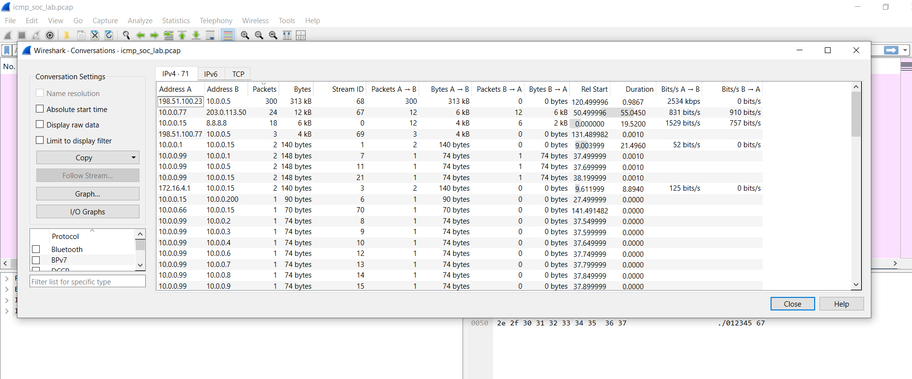
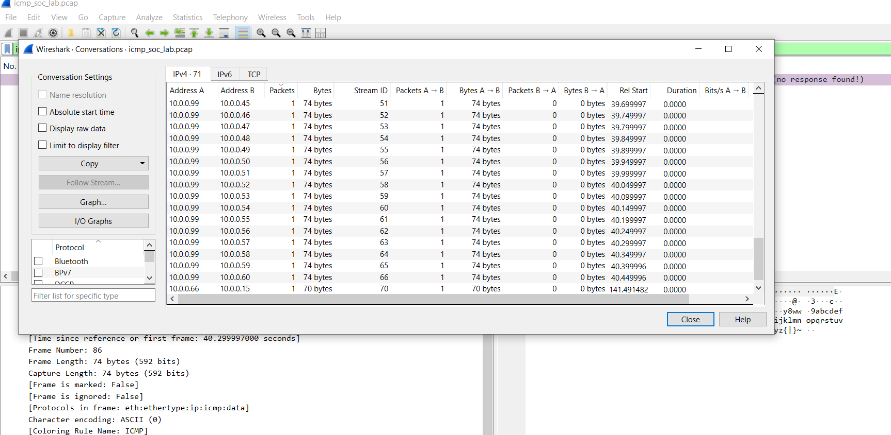
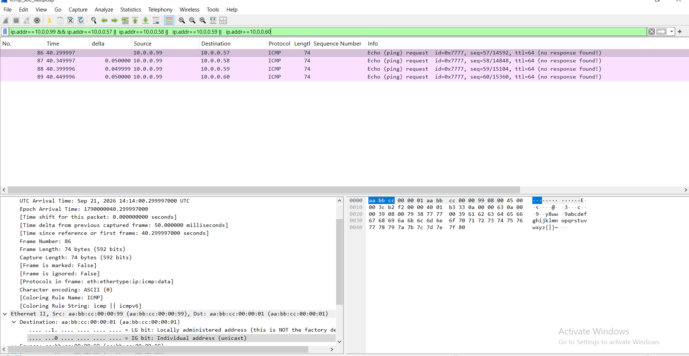
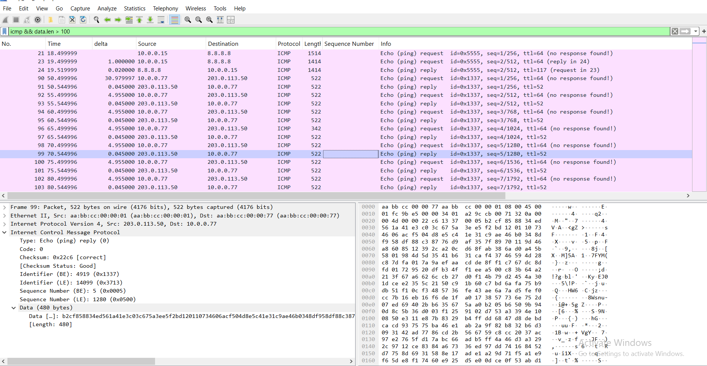
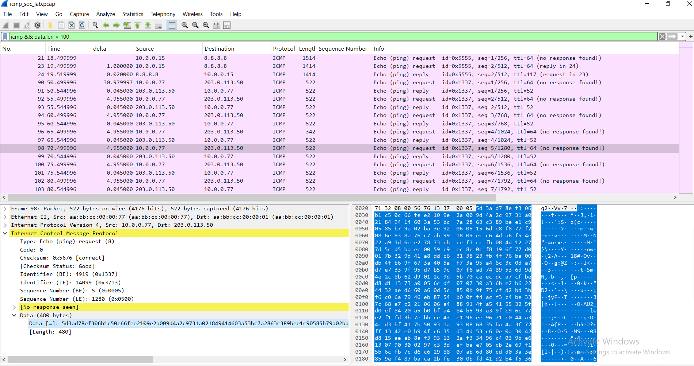
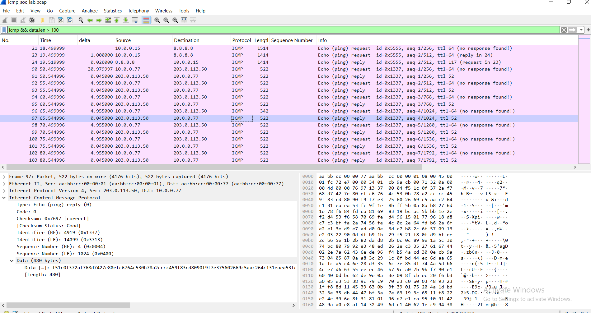
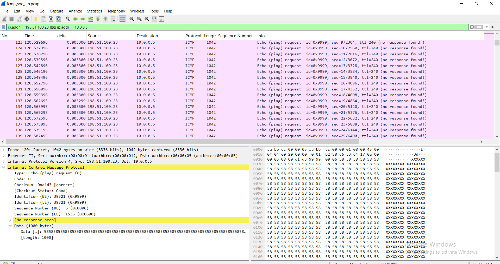
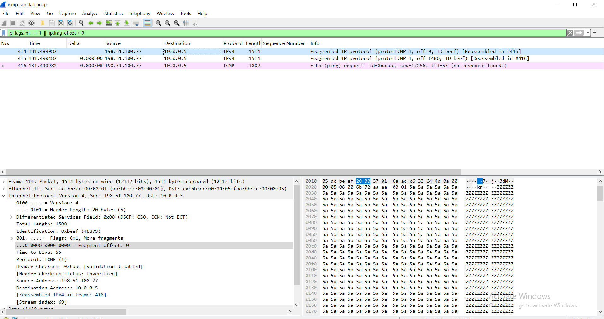

# Lab 01: ICMP Traffic Analysis

[Back to all labs](../../README.md)

A hands-on Wireshark project that separates **normal ICMP behaviour** from **malicious ICMP activity** in a 417-packet capture. I analysed the capture, documented the evidence and mapped each finding to MITRE ATT&CK.

> **Note:** `icmp_soc_lab.pcap` is a **synthetic** capture generated by `scripts/generate_pcap.py`. It was not captured from a real network. All addresses are private (RFC 1918) or documentation ranges (RFC 5737), so nothing in it points at real systems.

## Results at a glance

| Frames | Scenario | Verdict | Key evidence |
|---|---|---|---|
| 1-8 | User ping to 8.8.8.8 | Normal | Matching request/reply, 1 s apart, stable RTT |
| 9-20 | ICMP traceroute | Normal | TTL 1-6, type 11 from each hop |
| 21-24 | Path MTU discovery | Normal | DF set, type 3 code 4, retry succeeds |
| 25-26 | Host Unreachable | Normal | Type 3 code 1 from gateway for a dead host |
| 27-89 | Ping sweep from 10.0.0.99 | **Suspicious** | 60 sequential targets, 50 ms apart, 3 replies |
| 90-113 | ICMP tunnel 10.0.0.77 to 203.0.113.50 | **Suspicious** | 480-byte random payloads, 5 s beacon, reply data differs |
| 114-413 | ICMP flood from 198.51.100.23 | **Suspicious** | 300 packets in 0.99 s, 313 kB, no replies, TTL 240 |
| 414-416 | Fragmented echo from 198.51.100.77 | **Suspicious** | 4008-byte ICMP in 3 fragments, ID 0xBEEF |
| 417 | ICMP redirect from 10.0.0.66 | **Suspicious** | Not the gateway, names itself as next hop |

Full write-up with evidence and recommended actions: [FINDINGS.md](FINDINGS.md).

## Evidence

**Conversations overview.** The flood dominates by volume (300 packets, 313 kB, nothing returned). The sweep shows up as many one-packet conversations from one source.



**Ping sweep.** 10.0.0.99 probes each address once, 50 ms apart.




**ICMP tunnel.** Large payloads, fixed beacon, and a reply whose data differs from the request.





**ICMP flood.** 1042-byte echo requests every 3.3 ms, TTL 240, no responses.



**Fragmentation.** MF flag, offsets 0 and 1480, shared IP ID, reassembled in frame 416.



## Key filters

| Purpose | Filter |
|---|---|
| Sweep | `icmp.type == 8 && ip.src == 10.0.0.99`, `icmp.no_resp` |
| Tunnel | `ip.addr == 203.0.113.50 && icmp`, `icmp.type == 8 && data.len > 100` |
| Flood | `ip.src == 198.51.100.23 && icmp` |
| Fragmentation | `ip.flags.mf == 1 \|\| ip.frag_offset > 0`, `ip.id == 0xbeef` |
| Redirect | `icmp.type == 5 && ip.src != 10.0.0.1` |

More in [SCREENSHOT_GUIDE.md](SCREENSHOT_GUIDE.md).

## What I learned

- **Context decides.** One indicator is a lead, not proof. The tunnel is flagged because several indicators combine: payload size, entropy, timing, mismatched replies and a single external host.
- **Filters need tuning.** `data.len > 100` also matches the legitimate Path MTU discovery packets (frames 21, 23, 24), so a large payload alone isn't enough. The DF flag and the type 3 code 4 reply explain those.
- **Volume isn't the only signal.** The flood tops the packet counts, but the sweep only stands out when you look at how many distinct destinations one host talks to.
- **Baselines matter.** Knowing the real gateway (10.0.0.1, from the traceroute first hop and the MAC addresses) is what exposes the rogue redirect.

## Repository layout

```
pcap/icmp_soc_lab.pcap        the capture (417 packets)
scripts/generate_pcap.py      pure-Python generator (no dependencies)
screenshots/                  Wireshark evidence
FINDINGS.md                   analyst write-up per finding
SCREENSHOT_GUIDE.md           filters and screenshots for every scenario
```

From this folder, regenerate the capture with `python3 scripts/generate_pcap.py pcap/icmp_soc_lab.pcap`. Tunnel payloads use random bytes, so a regenerated file has the same structure but different payload content.

## Detection ideas

- Alert when one host sends echo requests to more than 20 distinct destinations within 10 seconds.
- Alert on echo payloads over 100 bytes, or replies whose payload differs from the request.
- Alert on fixed-interval ICMP to one external host (beaconing).
- Alert on more than 100 echo requests per second from one source to one destination.
- Alert on fragmented ICMP, and drop it at the perimeter.
- Alert on type 5 messages not sourced from a known gateway, and disable redirect acceptance on hosts.

## Limitations

- The capture is synthetic and cleaner than production traffic, which has far more noise.
- Some Ethernet details are simplified: every address the generator doesn't know, including unused hosts in the sweep, uses the gateway's MAC as the destination, so real ARP behaviour isn't modelled.
- Verdicts are based on this one capture. Intent and impact can't be proven from packets alone.

## Tools

Wireshark, Python 3 (standard library only).

## References

- RFC 792 (ICMP), RFC 791 (IP)
- MITRE ATT&CK: https://attack.mitre.org
- Wireshark display filter reference: https://www.wireshark.org/docs/dfref/
